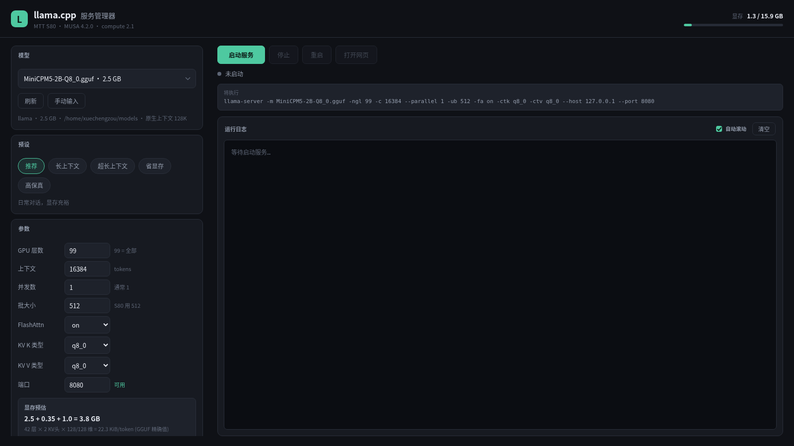

# llama.cpp 服务管理器

给本地 `llama-server` 套一层图形界面，省去记参数、敲命令。

界面用 **本地 Web UI** 实现（Python 标准库 HTTP 服务 + 浏览器渲染），
不依赖任何第三方包，也不需要 Tk/Qt 等 GUI 框架。



## 特性

- **模型自动发现** — 扫描 `~/models` 与 `~/.cache/llama.cpp` 下的 `.gguf`
- **读取真实元数据** — 直接解析 GGUF 头部，显示架构名、层数、原生上下文长度
- **显存精确预估** — 按真实模型参数计算 `模型 + KV cache + 计算缓冲`
- **实时显存监控** — 顶栏进度条随服务运行动态刷新
- **一键启停** — 启动 / 停止 / 重启，状态灯 + 运行时长
- **实时日志** — 服务输出流式展示，错误自动标红，支持精简过滤
- **预设档位** — 针对不同场景的参数组合，一键切换
- **自动纠错** — KV 量化没开 Flash Attention 时自动补上，避免启动失败

## 快速开始

```bash
./启动.sh
```

浏览器会自动打开 <http://127.0.0.1:8099>。

也可以直接用 Python 启动：

```bash
python3 gui_server.py
```

## 安装为桌面应用

```bash
# 复制 desktop 文件并替换路径
sed "s|@GUI_DIR@|$(pwd)|g" llama-cpp-gui.desktop.in \
    > ~/.local/share/applications/llama-cpp-gui.desktop
chmod +x ~/.local/share/applications/llama-cpp-gui.desktop
update-desktop-database ~/.local/share/applications
```

之后在应用菜单搜索「llama」即可打开。想让桌面上也有图标，把生成的
`.desktop` 复制到桌面目录即可。

## 配置

脚本顶部有几个常量需要按你的环境改：

```python
LLAMA_BIN_DIR = Path.home() / "deepseek_workspace/deepseek_harness/llama.cpp/build-musa/bin"
MUSA_LIB      = "/usr/local/musa/lib"
MUSA_INFO     = "/usr/local/musa/bin/musaInfo"
MODEL_DIRS    = [Path.home() / "models", Path.home() / ".cache/llama.cpp"]
GUI_PORT      = 8099
```

## 关于本机（MTT S80）的实测结论

GUI 里的默认值和预设不是照搬通用配置，而是按本机实测调出来的。

### 必须显式 `-fa on`

S80 的 MUSA 后端**默认不启用 Flash Attention**，`-fa auto` 会退化成关闭：

```
llama_context: layer 0 is assigned to device MUSA0 but
               the Flash Attention tensor is assigned to device CPU
               (usually due to missing support)
llama_context: Flash Attention was auto, set to disabled
```

强制 `-fa on` 后实测正常，且更快（12.78 → 16.19 tok/s）。

### KV 量化依赖 FA

如果用了 `-ctk q8_0` / `-ctv q8_0` 却没开 FA，server 会直接加载失败：

```
quantized V cache was requested, but this requires Flash Attention
```

GUI 已做自动纠正：检测到 KV 量化且 `-fa` 为 auto/off 时强制改成 `on`，
并在日志里提示。

### 显存占用参考

以 Qwen3-4B Q6_K（36 层 × 8 KV 头 × 128 维）为例：

| 上下文 | KV (f16) | KV (q8_0) | 总占用 (q8_0) |
|-------:|---------:|----------:|--------------:|
| 8192   | 1.12 GB  | 0.60 GB   | ~4.7 GB |
| 16384  | 2.25 GB  | 1.19 GB   | ~5.3 GB |
| 32768  | 4.50 GB  | 2.39 GB   | ~6.5 GB |
| 65536  | 9.00 GB  | 4.77 GB   | ~8.9 GB |
| 131072 | 18.0 GB  | 9.54 GB   | ~13.7 GB |

本机 16 GB 显存，桌面常驻约 1.1 GB，实际可用约 14.8 GB。

### 显存耗尽的后果很严重

这台机器**只有一块显卡，同时负责显示和计算**。实测显存耗尽时，
`mtgpu` 驱动会强制销毁**所有** GPU 客户端的显存上下文：

```
mtgpu: alloc segment_id(1) vram failed(-14) in bo create
mtgpu: comm = Xorg,        force destroy app memory context
mtgpu: comm = gnome-shell, force destroy app memory context
mtgpu: comm = chrome,      force destroy app memory context
```

结果就是整个桌面崩溃、退回登录界面。所以界面里显存预估超过空闲 90%
会标红警告——这不是保守，是真的会崩。建议留至少 3 GB 余量。

## 预设档位

| 档位 | 上下文 | KV | 预计占用 | 适用场景 |
|------|-------:|---:|---------:|----------|
| 推荐 | 16384 | q8_0 | ~5.3 GB | 日常对话 |
| 长上下文 | 65536 | q8_0 | ~8.9 GB | 长文档 |
| 超长上下文 | 131072 | q8_0 | ~13.7 GB | 极限，余量很小 |
| 省显存 | 8192 | q8_0 | ~4.7 GB | 同时开浏览器 / QQ |
| 高保真 | 16384 | f16 | ~6.4 GB | 不在意显存时 |

## 为什么不用 tkinter

最初的实现是基于 tkinter 的桌面窗口，但在本机遇到了硬伤：

本机 Tk 8.6 编译时**未启用 Xft**，无法使用 fontconfig 字体。
`tkinter.font.families()` 只能看到 20 个 X11 核心字体
（bitstream、clearlyu 之类），系统装的 Noto Sans CJK 完全不可见，
中文字形渲染成方框。

Web UI 方案完全绕开这个问题：中文、阴影、圆角、动画都由浏览器负责，
而且天然支持高分屏，改样式也不用重新编译。

## CI

`ci/github-actions.yml` 是准备给 GitHub Actions 的工作流（语法检查、
模块导入验证、预设结构校验、前端资源完整性、shellcheck）。

它没有直接放在 `.github/workflows/` 下，是因为推送工作流文件需要 token
具备 `workflow` 权限，而当前用的 token 没有。启用方法见
[`ci/README.md`](ci/README.md)。

本地也能跑等价检查：

```bash
python3 -m py_compile gui_server.py
```

## 依赖

- Python 3.8+
- 浏览器（Chrome / Firefox 等）
- 无第三方 Python 包

## 文件结构

```
.
├── 启动.sh              启动脚本（设置 LD_LIBRARY_PATH 后运行）
├── gui_server.py        HTTP 服务 + 进程管理 + GGUF 解析
├── llama-cpp-gui.desktop.in   桌面入口模板
├── ci/                  CI 配置与说明
├── docs/                截图
└── static/
    ├── index.html       界面结构
    ├── style.css        深色主题
    ├── app.js           前端交互与轮询
    └── icon.svg         应用图标
```

## API

后端也提供了一套简单的 HTTP API，方便脚本化调用：

| 方法 | 路径 | 说明 |
|------|------|------|
| GET | `/api/state?since=N` | 汇总状态（模型、显存、服务、增量日志） |
| GET | `/api/vram` | 仅显存信息 |
| GET | `/api/model-info?path=` | 模型元数据 |
| GET | `/api/port-check?port=` | 端口占用检查 |
| POST | `/api/start` | 启动服务 |
| POST | `/api/stop` | 停止服务 |
| POST | `/api/restart` | 重启服务 |
| POST | `/api/estimate` | 显存估算 |
| POST | `/api/clear-log` | 清空日志 |

启动请求体示例：

```json
{
  "model": "/home/user/models/Qwen3-4B-Q6_K.gguf",
  "ngl": 99, "ctx": 16384, "parallel": 1, "ub": 512,
  "fa": "on", "ctk": "q8_0", "ctv": "q8_0", "port": 8080
}
```

## 许可

MIT
